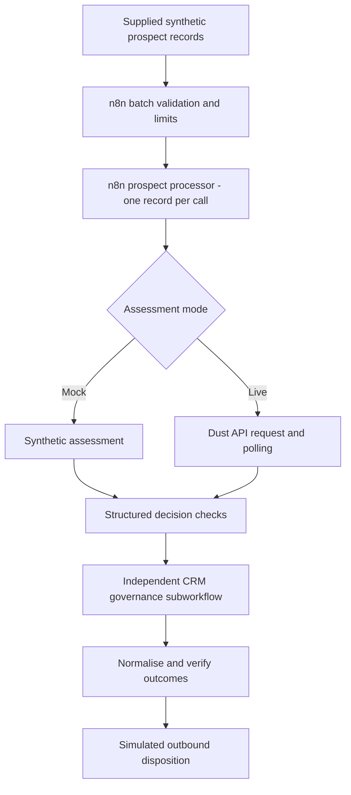

# Guardrailed AI Prospect Qualification

**Finance Transformation Signal Intelligence: a Dust and n8n prototype**

A Dust agent assesses finance transformation prospects for outbound. n8n validates its recommendation and applies CRM rules the agent can't override.

## Why I built this

I built this to work through a RevOps problem I've seen first-hand in go-to-market for enterprise finance software, and to demonstrate how a bounded AI agent can fit into GTM functions.

Many of us have seen AI being added to nearly every operational area. The concern I keep coming back to is what happens when that adoption, particularly when it's fragmented, moves faster than the policy and processes around it.

In outbound, for instance, without the proper guardrails, a probabilistic AI recommendation that feeds straight into the CRM or outreach tools can start deciding who gets contacted, and the business context held in the CRM gets pushed aside. The cost is practical. Reps lose time re-checking whether a prospect is really worth chasing, and the effects show up in performance and reporting, where outbound activity no longer lines up with the ICP.

I wanted to create a different split of responsibility. AI is good at weighing signals and recommending where effort should go. It isn't the right place to decide whether outreach is permitted. That belongs to the context and restrictions the business already records in its CRM (such as having an open opportunity or a do-not-contact flag), enforced by deterministic logic in the orchestration layer (n8n) that applies them the same way every time.

This project is a small, working version of that idea. A Dust agent returns a structured recommendation, n8n validates it against a fixed output contract, and a separate governance workflow enforces CRM restrictions independently of the AI's recommendation. If an assessment fails validation, errors or times out, no outbound action is taken. It's a prototype built on synthetic data, designed to show the pattern clearly and to be tested end to end.

## What it does

A Dust agent assesses a supplied prospect record and recommends a disposition. n8n then validates that output and runs a separate, deterministic CRM governance check. If the supplied CRM fields show an open opportunity, recent contact, a do-not-contact flag, an existing customer, an existing owner or a previous disqualification, the prospect is held, however strong the AI's recommendation.

The project focuses on the decision and governance layer. Prospect signals are supplied, it runs on synthetic data, and outbound actions are simulated, so in mock mode anyone can run it without a CRM or a Dust account.

## Where to start

- [`docs/architecture.md`](docs/architecture.md): how the workflows call each other, in mock and live mode.
- [`docs/design-decisions.md`](docs/design-decisions.md): the main choices I made and their trade-offs.
- [`docs/setup.md`](docs/setup.md): importing and relinking the workflows, starting with mock mode.
- [`docs/dust-agent.md`](docs/dust-agent.md): what the AI is asked to return and how its output is checked.
- [`evidence/test-execution-summary.md`](evidence/test-execution-summary.md): test results, including what they don't prove.
- [`workflows/`](workflows/): the four sanitised n8n workflow exports.
- [`samples/prospects-mock-batch.json`](samples/prospects-mock-batch.json): the five synthetic prospects used in the mock batch.

## Architecture

## Results

In the baseline mock regression (execution #473), five synthetic prospects gave four completed results and one rejection. The rejection was deliberate: P-B004 returns malformed AI output to prove the system rejects it rather than guessing. Of the four completed results, one went to the priority outbound queue and three were held by CRM rules. The batch finished as `PARTIAL_SUCCESS` with `verification_status: PASS`.

Two further tests (#483 and #484) confirmed that oversized batches are refused before any prospect is processed. After sanitising the files, I reimported and relinked them in my n8n workspace and reran the mock batch (#485), which gave the same results.

The live Dust path has run successfully in earlier versions of the project. I haven't rerun it against these exact release files, and I haven't tested them in a separate n8n instance.

## Limitations

- Input signals are supplied. The project doesn't find or verify them.
- CRM queue actions are simulated. Nothing is written to Salesforce or any outreach tool.
- Prospects are processed one at a time. This isn't built for parallel or high-volume use.
- Batches are capped at 25 records in mock mode and 5 in live mode. These are safety limits, not performance figures.
- Live polling stops accepting results after 120 seconds by default. That rejects late results but doesn't cancel a request already in progress.
- Imported workflows need their sub-workflow links reset. I've tested this by reimporting into my own n8n Cloud workspace, not on a separate installation.
- Live mode needs your own Dust workspace, agent and API key. None are included, and there's no hosted demo.

## How I built it

I defined the problem, the governance rules and the test scenarios, and I checked every result against them. ChatGPT and Claude helped with implementation, troubleshooting and documentation.

## Licence

The original material here is source-available under [PolyForm Noncommercial 1.0.0](LICENSE), with an [additional permission](ADDITIONAL_PERMISSION.md) so prospective employers and clients can run and evaluate it. Commercial use beyond that needs my permission; you can reach me through my GitHub profile. This isn't an OSI open-source licence. Dust, n8n and any other third-party tools stay under their own terms.
